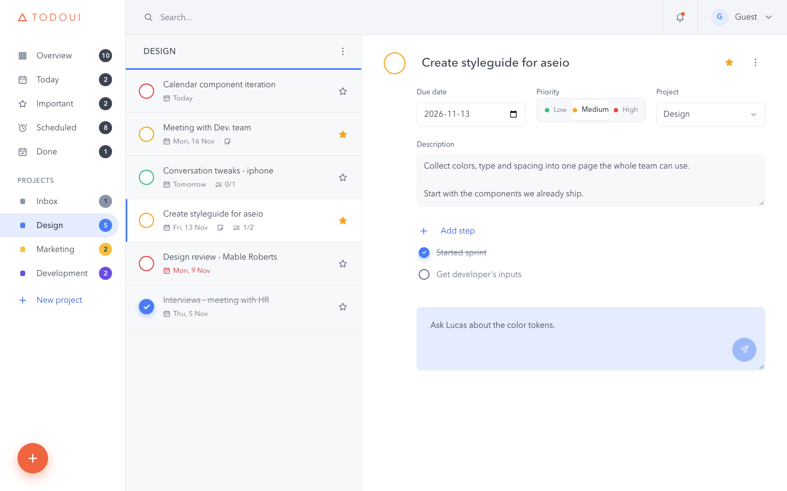
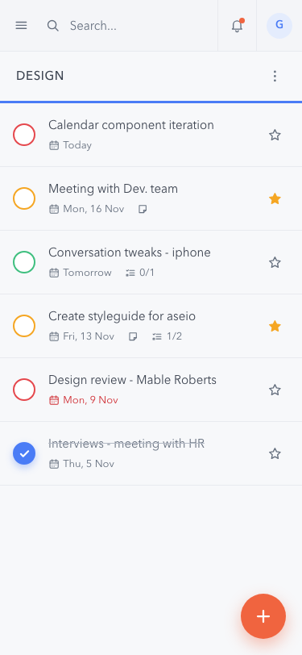

# TodoUI

A todo list app with projects, smart lists and search, built with plain JavaScript (ES modules and classes), webpack and `localStorage`. The layout follows the mockup in [TodosUI.png](TodosUI.png): sidebar, todo list and detail pane.



## Features

- **Projects:** a default **Inbox** that can't be renamed or deleted, plus your own projects with a color. Create, rename and delete them (from the ⋮ menu in the list header).
- **Todos:** title, description, due date, priority (low / medium / high), notes, a checklist of steps, a star (important) and done.
- **List view:** the round checkbox is colored by priority. Each row shows the due label ("Today", "Tomorrow", "Tue, 1 May"), icons for notes and steps, and a star. Overdue dates are red.
- **Detail pane:** click a todo to edit every field in place. Changes save when you leave a field. You can move a todo to another project, add and tick off steps, keep notes, and delete it (⋮ menu, with confirmation).
- **Smart lists** with count badges:
  - **Overview:** every open todo.
  - **Today:** open todos due today.
  - **Important:** open, starred todos.
  - **Scheduled:** open todos with a due date, sorted by date.
  - **Done:** completed todos.
- **Search** across all projects (title, description and notes).
- **Saved automatically** to `localStorage`. Missing or corrupt saved data never breaks the app: it starts fresh with the Inbox.
- **Responsive:**
  - Below 1024 px the detail pane slides over the list.
  - Below 768 px the sidebar becomes a drawer behind the ☰ button.
- **Keyboard and screen reader friendly:**
  - every control has a label;
  - focus is always visible;
  - Esc closes dialogs, menus, the drawer and the detail overlay;
  - focus is kept in place when the screen updates.



The bell icon and the "Guest" user are placeholders without behavior.

## Getting started

You need [Node.js](https://nodejs.org/) (developed with Node 26 and npm 11).

```bash
npm install
npm run dev      # http://localhost:8080 with live reload
```

## npm scripts

| Script | What it does |
|---|---|
| `npm run dev` | Development server with live reload |
| `npm run build` | Production bundle in `dist/` |
| `npm run lint` / `npm run lint:fix` | ESLint |
| `npm run format` / `npm run format:check` | Prettier (Markdown is excluded) |
| `npm test` / `npm run test:watch` / `npm run test:coverage` | Jest unit tests |

## Architecture

The code is split into layers. Only `ui/` touches the DOM.

```
src/
├── index.js            entry point: wires storage, event bus, ProjectManager and App
├── template.html       three-pane page shell
├── styles/             design tokens (variables.css) and one stylesheet per area
└── js/
    ├── models/         ChecklistItem, Todo, Project: plain data classes
    ├── core/           EventBus, ProjectManager (all changes), TodoQuery (lists, search, counts)
    ├── storage/        StorageService: versioned save/load to localStorage
    ├── ui/             App controller, DOM helpers, components (Sidebar, TodoListView, ...)
    └── utils/          constants, ids, date formatting (date-fns), debounce, color contrast
```

How a change flows through the app:

```
click ──► UI component ──► App ──► ProjectManager ──► models
                                        │
                                        └─ emits "state:changed"
                                              ├─► StorageService.save()  (autosave)
                                              └─► App.render()           (redraw)
```

- **One way to change data.** The UI only calls `ProjectManager` methods, and every change emits `state:changed`. Saving and redrawing both listen to that one event.
- **Components get plain data and callbacks.** For example, `TodoListView` receives rows like `{ title, dueLabel, priority, ... }` and reports clicks; it never imports storage or edits model objects.
- **Saved data comes back as classes.** Each model has `toJSON()` and `static fromJSON()`, so todos loaded from `localStorage` get their methods back. The data is saved under the key `todoui.v1` as `{ version: 1, projects, activeView }`. If it can't be read, the app starts with an empty Inbox instead of crashing.
- **Dates** are stored as `yyyy-MM-dd` (or `null`) and formatted only in `utils/dateFormat.js`.

## Tests

The logic layer (`models/`, `core/`, `storage/`, `utils/`) is covered by Jest unit tests in [tests/](tests/), mirroring the source folders. The UI was checked by hand and in a headless browser, including an accessibility audit with axe-core.

```bash
npm test
```

## Project docs

- [projectbrief.md](projectbrief.md): the assignment
- [plan.md](plan.md): scope, architecture and task list
- [CLAUDE.md](CLAUDE.md): working agreement and progress log
